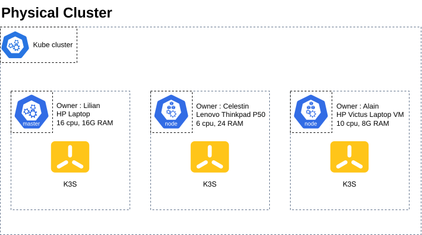
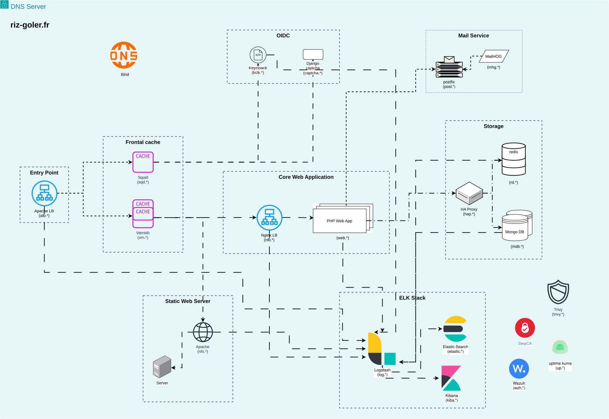

# Infrastructure

Documentation technique de l'infrastructure physique et logicielle du projet `ntiers`.

## Sommaire

- [Infrastructure physique](#infrastructure-physique)
- [Système](#système)
- [Réseau](#réseau)
- [Cluster](#cluster)
- [Services](#services)

## Infrastructure physique

| Machine                  | Owner    | CPU | RAM (Go) |
|:-------------------------|:---------|:---:|:--------:|
| HP Laptop                | Lilian   | 16  | 16       |
| HP Victus Laptop (VM)    | Alain    | 10  | 8        |
| Lenovo Thinkpad P50 (VM) | Celestin | 6   | 24       |

## Système

Toutes les machines tournent sous **Ubuntu 26.04**.

| Hostname        | Owner    |
|:----------------|:---------|
| `ntiers-lilian` | Lilian   |
| `kube`          | Celestin |
| `kbs`           | Alain    |

## Réseau

Pour que nos machines puissent communiquer à tout moment, nous utilisons un réseau virtuel [Tailscale](https://tailscale.com/) (offre Basic gratuite).

| Hostname        | IP Tailscale |
|:----------------|:------------:|
| `ntiers-lilian` |              |
| `kube`          |              |
| `kbs`           |              |

## Cluster

Les machines sont regroupées dans un cluster Kubernetes déployé avec [k3s](https://k3s.io/), installé directement sur Ubuntu 26.04. Le cluster compte **1 master** et **2 workers**.

| Hostname        | Rôle   | Owner    |
|:----------------|:-------|:---------|
| `kube`          | master | Celestin |
| `ntiers-lilian` | worker | Lilian   |
| `kbs`           | worker | Alain    |

## Services

Les services sont exposés sous le domaine `riz-goler.fr`.

| Catégorie            | Services                                     |
|:---------------------|:---------------------------------------------|
| DNS Server           | Bind                                         |
| Entry Point          | Apache LB                                    |
| Frontal cache        | Varnish, Squid                               |
| Static Web Server    | Apache                                       |
| Core Web Application | Nginx LB, PHP Web App                        |
| OIDC                 | Keycloak, Django captcha                     |
| Storage              | HA Proxy, Redis, MongoDB                     |
| Mail Service         | Postfix, MailHog                             |
| ELK Stack            | Logstash, Elasticsearch, Kibana              |
| Sécurité             | Trivy, Wazuh, StepCA                         |
| Monitoring           | Uptime Kuma                                  |

Le détail des sous-domaines et la répartition de la configuration par personne sont dans [repartition_taches.md](repartition_taches.md).
